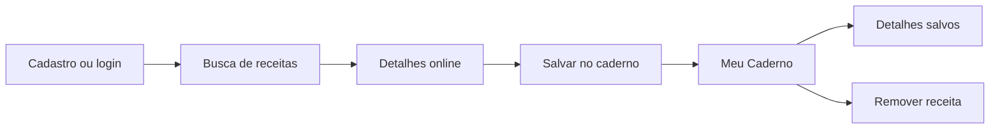

# Chef's Shelf — Especificação de Requisitos de Software

| Campo | Valor |
| --- | --- |
| Projeto | Chef's Shelf — Caderno de Receitas Digital |
| Cliente | GourmetGo |
| Plataforma | Aplicativo Flutter para Android |
| Documento | Especificação de Requisitos de Software (SRS), versão 1.0 |
| Data | 22/10/2026 |
| Referência metodológica | ISO/IEC/IEEE 29148:2018 |

## 1. Introdução

### 1.1 Propósito e escopo

O Chef's Shelf deve permitir que usuários descubram receitas online e guardem cópias completas em um caderno pessoal. O escopo inclui cadastro e login, busca na TheMealDB, visualização de imagem, ingredientes e instruções, salvamento no Cloud Firestore, consulta do caderno e exclusão de receitas salvas. Cada usuário deve acessar somente o próprio caderno.

O caderno permite salvar, consultar e excluir receitas. A edição de receitas salvas está fora do escopo.

### 1.2 Definições e siglas

| Termo | Significado |
| --- | --- |
| Receita online | Receita retornada pela TheMealDB |
| Receita salva | Cópia estruturada de uma receita online no Firestore |
| Caderno | Conjunto de receitas salvas de um usuário autenticado |
| RF / RNF / RN | Requisito funcional / não funcional / regra de negócio |
| SRS | Especificação de Requisitos de Software |

## 2. Descrição geral

### 2.1 Perspectiva e usuários

O aplicativo usa Flutter na interface, TheMealDB como fonte de receitas, Firebase Authentication para identificar contas e Cloud Firestore para guardar o caderno.

| Ator | Necessidade |
| --- | --- |
| Visitante | Criar uma conta ou entrar em uma conta existente |
| Usuário autenticado | Buscar receitas, ver detalhes e gerenciar o próprio caderno |

### 2.2 Ambiente, restrições e dependências

- O aplicativo utiliza Flutter e Dart, com Firebase Authentication e Cloud Firestore para autenticação e persistência.
- Busca online depende de internet e da TheMealDB. Login e sincronização dependem dos serviços Firebase.
- A [TheMealDB](https://www.themealdb.com/api.php) oferece a chave de teste `1` para desenvolvimento ou uso educacional; a publicação em loja está sujeita às condições da API.
- Documentos de receitas devem estar em `users/{uid}/recipes/{recipeId}`. O acesso é definido em [firestore.rules](firestore.rules).
- Compartilhamento de cadernos, cadastro manual de receitas, perfis adicionais e suporte offline garantido não estão no escopo definido.

## 3. Requisitos funcionais

Cada RF tem identificador estável e um resultado observável para aceitação.

### RF-01 — Cadastrar usuário

O sistema deve permitir criar uma conta para identificar o dono do caderno. **Aceitação:** cadastro válido cria uma conta autenticável; dados inválidos ou conta existente produzem erro sem abrir o caderno.

### RF-02 — Entrar e sair da conta

O sistema deve permitir entrar com conta cadastrada e encerrar a sessão. **Aceitação:** credenciais válidas abrem o caderno da conta; credenciais inválidas mostram erro; após sair, o caderno fica indisponível até novo login.

### RF-03 — Buscar receitas online

O sistema deve buscar receitas por nome na TheMealDB. **Aceitação:** resultados encontrados são exibidos; uma busca sem resultados informa o estado vazio; falha de rede ou da API é comunicada ao usuário.

### RF-04 — Exibir detalhes online

Ao selecionar um resultado, o sistema deve exibir título, imagem quando disponível, ingredientes com medidas e instruções na ordem recebida. **Aceitação:** os detalhes correspondem à receita selecionada e ingredientes vazios da API não aparecem.

### RF-05 — Salvar receita no caderno

O sistema deve copiar os dados da receita da API para o Firestore do usuário autenticado. **Aceitação:** a receita aparece no caderno com título, imagem, ingredientes e instruções; seus detalhes podem ser lidos do Firestore sem nova consulta à TheMealDB; salvar a mesma receita novamente não cria duplicata.

### RF-06 — Listar receitas salvas

O sistema deve ler as receitas do caderno do usuário autenticado. **Aceitação:** a lista contém somente receitas dessa conta; quando vazia, exibe mensagem apropriada.

### RF-07 — Exibir detalhes salvos

Ao selecionar uma receita do caderno, o sistema deve mostrar todos os dados armazenados. **Aceitação:** imagem, ingredientes e instruções vêm do documento salvo e preservam a ordem das listas.

### RF-08 — Remover receita do caderno

O sistema deve permitir excluir uma receita salva. **Aceitação:** após exclusão bem-sucedida, ela deixa de aparecer na lista; uma falha é informada e não é apresentada como sucesso.

### RF-09 — Restringir acesso ao caderno

O sistema deve associar o caderno à conta autenticada e impedir acesso a receitas de outra conta. **Aceitação:** leituras e gravações no caminho de outro `uid` são negadas pelas regras do Firestore, inclusive fora da interface.

## 4. Requisitos não funcionais

| ID | Requisito | Critério de verificação |
| --- | --- | --- |
| RNF-01 | Estrutura dos dados | `ingredients`, `instructions` e `tags` são arrays de strings no Firestore; cada medida acompanha seu ingrediente. |
| RNF-02 | Segurança | As regras exigem autenticação e igualdade entre `request.auth.uid` e o `uid` do caminho para ler ou gravar receitas. |
| RNF-03 | Integridade | Falha ao salvar, carregar ou excluir não é exibida como operação concluída. |
| RNF-04 | Usabilidade | Busca, detalhes e caderno apresentam estados de carregamento, vazio ou erro quando aplicáveis. |
| RNF-05 | Manutenibilidade | Dados, integração, coordenação e interface ficam separados em Model, Services, Controllers e Views. |

## 5. Regras de negócio e modelo de dados

| ID | Regra |
| --- | --- |
| RN-01 | Cada receita salva pertence a uma conta Firebase identificada pelo `uid`. |
| RN-02 | Salvar cria uma cópia dos detalhes da API; uma nova consulta à API não é necessária para ler a cópia. |
| RN-03 | Ingredientes vazios da TheMealDB são ignorados; ingrediente e medida formam uma string. |
| RN-04 | Instruções são armazenadas em uma lista de strings na ordem de preparo. |
| RN-05 | A exclusão atua apenas no caderno da conta autenticada. |
| RN-06 | O identificador da receita na TheMealDB identifica uma única receita em cada caderno. |

As receitas online e salvas seguem a mesma estrutura de dados. Os campos `idMeal`, `strMeal`, `strMealThumb`, `strIngredient1` a `strIngredient20`, `strMeasure1` a `strMeasure20` e `strInstructions` da TheMealDB são convertidos para:

```text
users/{uid}/recipes/{recipeId}
  id: string                 // ID da TheMealDB
  title: string
  imagePath: string | null
  category: string | null
  area: string | null
  tags: string[]
  ingredients: string[]      // exemplo: ["2 cups flour", "1 egg"]
  instructions: string[]     // passos em ordem
```

O campo `recipeId` no caminho do documento usa o `idMeal` retornado pela TheMealDB. Uma receita aparece uma única vez em cada caderno.

## 6. Interfaces e fluxo

| Interface | Papel | Operação |
| --- | --- | --- |
| TheMealDB | Busca e detalhes | `GET /api/json/v1/1/search.php?s={nome}`; `GET /api/json/v1/1/lookup.php?i={id}` quando necessário |
| Firebase Authentication | Identificação | Cadastro, login, sessão e logout |
| Cloud Firestore | Persistência | Criar, ler e excluir em `users/{uid}/recipes` |

| Tela | Responsabilidade |
| --- | --- |
| Autenticação | Cadastro e login |
| Busca | Pesquisa e resultados da TheMealDB |
| Detalhes | Imagem, ingredientes, instruções e ação de salvar uma receita online |
| Meu Caderno | Lista, abertura de detalhes e exclusão de receitas salvas |



## 7. Rastreabilidade e verificação

| Funcionalidade | Requisitos | Verificação |
| --- | --- | --- |
| Autenticação | RF-01, RF-02, RF-09, RNF-02 | Cadastro, login, logout e tentativa de acesso entre contas |
| Busca e visualização | RF-03, RF-04 | Busca com resultado, sem resultado e com erro; inspeção dos detalhes |
| Salvar no caderno | RF-05, RNF-01, RN-02 a RN-04, RN-06 | Conferir documento Firestore, ausência de duplicatas e abertura sem nova consulta à API |
| Meu Caderno | RF-06, RF-07 | Conferir lista e detalhes após autenticação |
| Deleção | RF-08, RN-05 | Excluir e confirmar ausência do documento |
